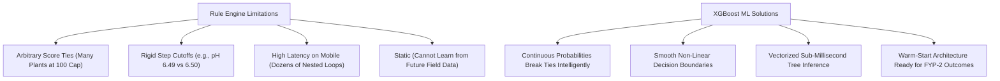

# Plantify Karachi — Core Academic Defense & ML Justification

> **Document Purpose:** This reference document explains the academic rationale, machine learning design choices, and defense strategy for Plantify Karachi (FYP-1). It directly addresses supervisor inquiries, viva examinations, and thesis documentation regarding the use of machine learning over a deterministic rule engine.

---

## 1. Executive Summary & Core Paradox

In our testing across 21 held-out Karachi reference sites (44,625 unseen test scenarios), the XGBoost classifier achieves **99.987% accuracy** and an **ROC-AUC of 0.99999993**.

### The Examiner's Question:
> *"Since the training data labels (`suitable = 0` or `1`) were generated by the supervisor's planting guide rule engine, isn't training a machine learning model just circular logic? Why not use the rule engine directly?"*

### The Academic Defense:
* **What 99.98% Accuracy Really Means:** It demonstrates **algorithmic fidelity**—proving that the tree ensemble has mastered the multi-attribute boundaries of Karachi's domain rules with near-zero error across unseen geographic sites. It does **not** claim physical plant survival in the field.
* **Paradigm Classification:** This architecture belongs to established AI paradigms:
  1. **Surrogate Modeling (Knowledge Distillation):** Compacting multi-criteria expert rules into an optimized, continuous mathematical model.
  2. **Weak Supervision:** Bootstrapping an AI system when localized physical outcome data does not yet exist.

---

## 2. Four Technical Reasons Why Machine Learning is Necessary

If the project relied solely on the rule engine, the system would suffer from several technical and practical limitations:

### 1. Resolving Score Ties (The 100-Point Ceiling)
* **The Problem:** In multi-criteria rule engines, multiple candidate species frequently receive the exact same score (often tied at the maximum 100-point score cap). The rule engine has no mathematical mechanism to prioritize one over another; it falls back to sorting by CSV index or alphabetical order.
* **The ML Solution:** XGBoost outputs a continuous calibrated probability (e.g., `0.9841` vs. `0.9120`). This allows the system to differentiate between tied candidates by assessing multi-factor trade-offs across 66 dimensions.
* **Why Top-6 Overlap is ~50.6%:** This metric proves that XGBoost does not blindly clone the arbitrary tie-breaking of the rule engine. It provides a nuanced, probabilistic ranking that reorders tied species intelligently.

### 2. Smooth Logistic Boundaries vs. Rigid Cutoffs
* Rule engines use hard thresholds (e.g., if a plant's minimum pH is 6.5, a soil reading of 6.49 results in an immediate 0 score).
* Real-world soil and weather measurements carry sensor and spatial noise. XGBoost models smooth continuous logistic curves around decision boundaries, making recommendations more robust against minor measurement variations.

### 3. Sub-Millisecond Inference on Mobile Devices
* Evaluating dozens of nested `if-else` branches, string parsing, and penalty weights across 85 species for every user query introduces unnecessary computational overhead on client devices.
* A serialized XGBoost tree (`.joblib` or ONNX) executes vectorized predictions in milliseconds, allowing instant responsiveness in the web and mobile interfaces.

### 4. The Foundation for FYP-2 (Cold-Start to Fine-Tuning)
* Karachi currently has no digitized, localized registry tracking 1-year or 2-year survival outcomes of urban plantation projects.
* Relying on expert guidance to bootstrap a system is the standard industry solution for the **Cold-Start Problem**.
* In FYP-2, when real citizen observations and nursery outcomes are collected via the app, the XGBoost model can be **fine-tuned** on actual biological data without rewriting the underlying recommendation engine from scratch.

---

## 3. Recommended Viva & Presentation Vocabulary

To maintain academic rigor during project defense and thesis writing, use precise terminology:

| ❌ What NOT to Say | ✅ What to Say Instead |
| :--- | :--- |
| *"Our AI predicts whether a plant will survive with 99.98% accuracy."* | *"Our XGBoost model acts as a continuous surrogate ranker that learns domain expert rules with 99.98% fidelity."* |
| *"The ML model replaces the expert rules."* | *"We use a two-stage hybrid engine: Stage 1 enforces deterministic safety rules, while Stage 2 optimizes multi-criteria ranking."* |
| *"The top-6 overlap of 50.6% means the model made errors."* | *"The 50.6% overlap reflects the resolution of score ties where the rule engine sorted arbitrarily, whereas XGBoost ranked by continuous probability."* |

---

## 4. Key Defense Q&A Sheet

### Q1: What dataset was used to train the model?
> **Answer:** *"Because no historical planting outcome database exists for Karachi, we synthesized 221,000 realistic scenarios (104 Karachi reference sites × 25 user profiles × 85 candidate species). Each scenario integrates SoilGrids 2.0 soil metrics, ISRIC satellite soil salinity projections, and 10-year climate averages, labeled according to the supervisor's expert planting guide."*

### Q2: Did you split the dataset randomly?
> **Answer:** *"No. A random row split would cause severe geographical data leakage because the same site would appear in both train and test sets. We used a site-stratified `GroupShuffleSplit` on `site_id`, ensuring that 21 Karachi locations (44,625 rows) were completely unseen during training."*

### Q3: What is the primary role of the Machine Learning layer?
> **Answer:** *"The ML layer acts as Stage 2 of a two-stage hybrid recommender. Stage 1 deterministically eliminates fatal risks (toxic plants near children, invasive roots in small spaces, high salinity). Stage 2 uses XGBoost to compute continuous suitability probabilities over the surviving candidates, resolving score ties and ranking the optimal Top-6 species."*

