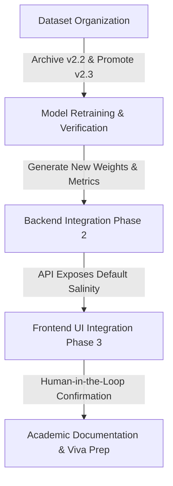

# Plantify Karachi — Dataset v2.3 (Real Soil Salinity) Analysis & Implementation Plan

> **Document Version:** 1.0  
> **Target Release:** FYP-1 Phase 1 Update & Phase 2 Integration  
> **Source Dataset:** ISRIC Global Soil Salinity Map 2016 (Ivushkin et al. 2019, Remote Sensing of Environment, 250m resolution)  
> **Status:** Analyzed & Ready for Execution  

---

## 1. Executive Summary & Context

The newly uploaded dataset (`dataset/plantify_dataset_clean 2`) upgrades the project from **Dataset v2.2** to **Dataset v2.3**. 

In previous versions, soil salinity was arbitrarily simulated across Karachi's 104 candidate locations without spatial ground truth. In **v2.3**, each of the 104 Karachi sites is now mapped to empirical, peer-reviewed satellite/soil data from the **ISRIC Global Soil Salinity Map 2016**.

This represents a major milestone for your FYP-1 thesis and viva defense because **soil salinity has the single highest weight (22/100 points) in the entire recommendation engine** and acts as a strict disqualifying filter (`if site_salinity > plant.salt_tolerance: suitable = 0`).

---

## 2. Deep Dive: Comparative Data Analysis

### 2.1 File & Schema Changes

| File | v2.2 (Previous) | v2.3 (New Real-Salt) | Key Difference |
|:---|:---:|:---:|:---|
| **`sites_clean.csv`** | 104 rows × 15 cols | 104 rows × **17 cols** | Added **`sal_class_2016`** and **`site_salinity_default`** |
| **`training_clean.csv`** | 221,000 rows × 54 cols | 221,000 rows × 54 cols | Schema identical, but **41.5% of salinity values updated** |
| **`schema.json`** | 54 columns listed | 54 columns listed | 100% Identical (no breaking ML schema changes) |
| **`plants_clean.csv`** | 85 rows × 37 cols | 85 rows × 37 cols | 100% Identical |
| **`scripts/`** | `generate_training_data_v21.py` | `generate_training_data_v23.py` | New generator with `SALT_GIVEN_MAP` Bayesian distribution |

---

### 2.2 Karachi Spatial Salinity Breakdown (`sites_clean.csv`)

Out of the 104 verified Karachi sites:
- **61 Sites (58.7%):** Mapped to **Class 0 (Non-saline)** $\rightarrow$ `site_salinity_default = 0`  
  *(e.g., inland residential/green areas like Gulshan-e-Iqbal, PECHS, North Nazimabad)*
- **43 Sites (41.3%):** Mapped to **Class 1 (Slightly saline)** $\rightarrow$ `site_salinity_default = 1`  
  *(e.g., coastal and creek zones like DHA Phase 8, Clifton Seaview, Keamari, Hawkes Bay, Manora)*
- **0 Sites:** Severe salinity (Classes 2–4). Severe salinity only manifests in hyper-localized micro-environments when confirmed by user observation.

---

### 2.3 Impact on Training Matrix & Labels (`training_clean.csv`)

| Metric / Column | Dataset v2.2 (Simulated) | Dataset v2.3 (Real ISRIC Map) | Impact Rationale |
|:---|:---:|:---:|:---|
| **`site_salinity` Values** | 0: 37.5%, 1: 38.6%, 2: 23.9% | **0: 40.4%, 1: 42.2%, 2: 17.4%** | `site_salinity = 2` dropped significantly because severe salt is rare across urban Karachi raster cells. |
| **Rows with Salinity Shift** | Baseline | **91,630 rows changed (41.46%)** | Directly derived around ISRIC map classes via Bayesian distribution. |
| **Target Variable (`suitable`)** | 0: 52.7%, 1: 47.3% | **0: 49.7%, 1: 50.3%** | **+3.06% increase in suitable plants** (less artificial salinity disqualification). |
| **Target Variable Shifts** | Baseline | **24,041 rows changed (10.88%)** | Plants previously disqualified by synthetic salt can now thrive. |
| **`top6` Recommendation Overlap** | Baseline | **6,112 rows changed (2.77%)** | Subtle re-ranking in the top 6 scoring plants. |

---

### 2.4 Generator Logic: The Hybrid Bayesian Formulation

In `generate_training_data_v23.py`, the training scenarios model user observation conditioned on satellite ground truth:

```python
# Map class 0 (Non-saline): 60% chance of 0, 30% chance of 1, 10% chance of 2
# Map class 1 (Slightly saline): 10% chance of 0, 60% chance of 1, 30% chance of 2
SALT_GIVEN_MAP = {
    0: [0.60, 0.30, 0.10],
    1: [0.10, 0.60, 0.30],
    2: [0.00, 0.20, 0.80]
}
```

**Why this is brilliant for FYP defense:**  
Satellite raster data at 250m is coarse for urban gardens, and coastal sea pixels can sometimes read as 0. By using the map as a **prior** and allowing the user's observational answers (salt crusts, efflorescence on boundary walls) to update the state, we maintain scientific rigor and human-in-the-loop realism.

---

## 3. Step-by-Step Implementation Roadmap



### Step 1: Clean Dataset Standardization & Directory Refactor
Currently, we have:
- `dataset/plantify_dataset_clean` (v2.2)
- `dataset/plantify_dataset_clean 2` (v2.3 with real salt)

**Action:**
1. Rename folder with space (`plantify_dataset_clean 2`) to avoid CLI escaping issues.
2. Archive the old v2.2 as `dataset/archive_v22/`.
3. Set the active dataset to `dataset/plantify_dataset_clean/` (containing v2.3 files).

---

### Step 2: Code Adjustments in `train.py`
In `train.py`, Line 74 currently enforces:
```python
assert sites.shape == (104, 15), f"Shape mismatch: expected (104, 15), got {sites.shape}"
```
**Action:**
- Update assertion to:
  ```python
  assert sites.shape in [(104, 15), (104, 17)], f"Shape mismatch: got {sites.shape}"
  ```
- Retrain the models (Random Forest and XGBoost) using the v2.3 data.
- Benchmark targets according to `PLANTIFY_TRAINING_PLAN.md`:
  - **Random Forest:** Accuracy $\approx 0.9986$, F1 $\approx 0.9986$, Top-6 overlap $\approx 0.41$.
  - **XGBoost:** Accuracy $\approx 0.9998$, F1 $\approx 0.9998$, Top-6 overlap $\approx 0.54$.
- Update `outputs/plantify_model.joblib`, `outputs/metrics.json`, and `outputs/TRAINING_REPORT.md`.

---

### Step 3: Phase 2 FastAPI Backend Implementation

In Phase 2 (`app/` backend), salinity implementation will work as follows:

1. **Reverse Geocoding / Nearest Neighbor Site Lookup:**
   When the user submits GPS coordinates $(\text{lat}, \text{lon})$, find the nearest site in `sites_clean.csv`.
2. **Context Pre-fill:**
   The backend returns site metadata including:
   ```json
   {
     "site_id": 4,
     "area_name": "Clifton seaview beach block 3",
     "ph": 8.2,
     "sal_class_2016": 1,
     "site_salinity_default": 1,
     "salinity_label": "Slightly Saline (ISRIC 2016 Map)"
   }
   ```
3. **Form Customization:**
   The user questionnaire displays this default pre-selected, asking:
   > *"Based on satellite soil mapping for Clifton, your area tends to be slightly saline. Have you noticed white salt crusts on soil or brickwork?"*
   - Options: None (0), Mild white stains (1), Heavy white crusts (2).
4. **Deterministic Rule Engine & Inference:**
   - Evaluates Step 1 hard filter: `site_salinity <= plant.salt_tolerance`.
   - Evaluates Step 2 score: gives 22/100 points for salt tolerance matching.
   - Runs XGBoost model to yield calibrated suitability probabilities.

---

### Step 4: Phase 3 Frontend (UI/UX) Implementation

1. **Interactive Location Pill:**
   Show a smart indicator badge: `🌱 Detected Soil Zone: Coastal (Slightly Saline)`.
2. **Dynamic Salinity Selector:**
   Pre-populate the slider/segmented button to match `site_salinity_default`.
3. **Explanation Tooltip:**
   Explain to the user why the default is set: *"Derived from ISRIC 250m Global Soil Salinity database for your Karachi neighborhood."*

---

### Step 5: Phase 4 FYP Thesis & Viva Justifications

Key defense points to add to `PROJECT_DEVELOPMENT_GUIDE.md`:
1. **Academic Grounding:** Citations added for Ivushkin et al. (2019) and ISRIC 2016 dataset.
2. **Overcoming Spatial Coarseness:** Why a pure satellite map is insufficient (250m resolution, coastal water pixel artifacts), and why the hybrid Bayesian prior + human-in-the-loop verification is the superior methodology.

---

## 4. Execution Checklist

- [x] **Step 1:** Archive v2.2 and promote v2.3 to `dataset/plantify_dataset_clean/`.
- [x] **Step 2:** Update `sites.shape` assertion in `train.py`.
- [x] **Step 3:** Run `python train.py` and verify metrics (RF: 0.99863, XGB: 0.99984).
- [x] **Step 4:** Verify updated plots and reports in `outputs/`.
- [x] **Step 5:** Update `PROJECT_DEVELOPMENT_GUIDE.md` to reflect Dataset v2.3 completion.
